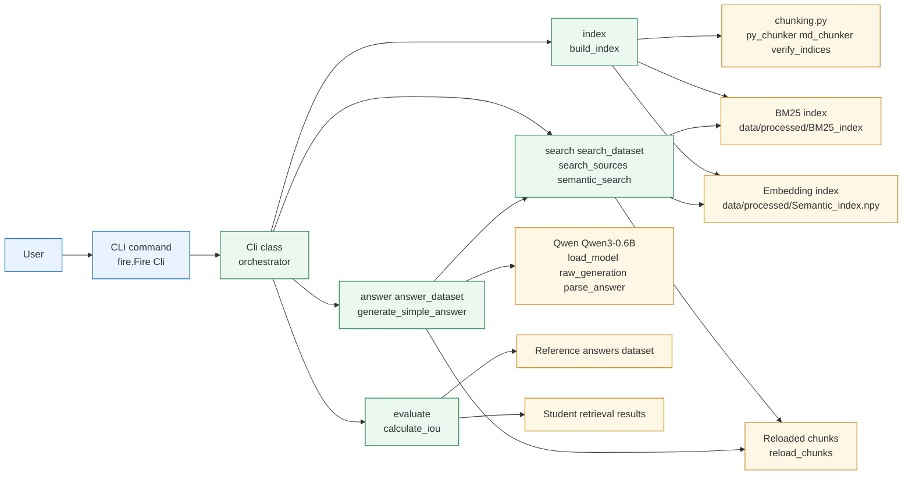
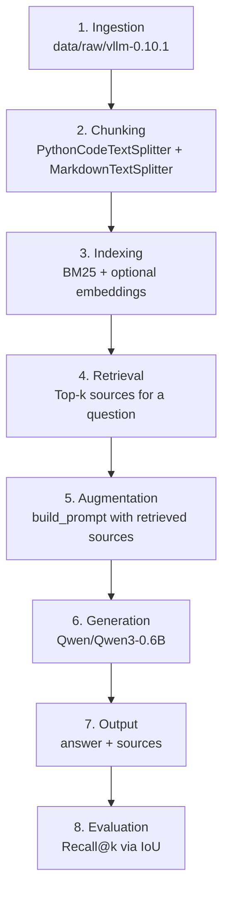
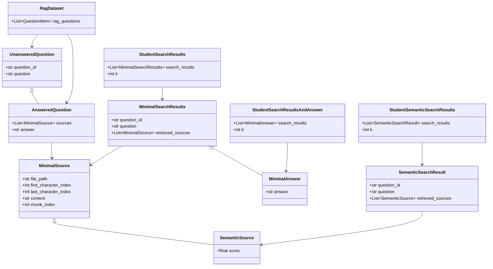

# Hybrid-Code-RAG

# Description

**Hybrid-Code-RAG** is a Retrieval-Augmented Generation (RAG) system designed to answer questions about a codebase.

The project implements a complete RAG pipeline:

1. **Indexing** — ingest and split the provided vLLM corpus into searchable chunks.
2. **Retrieval** — retrieve the most relevant chunks for a given question.
3. **Augmentation** — provide the retrieved sources as context to a language model.
4. **Generation** — use `Qwen/Qwen3-0.6B` to generate a grounded, coherent and on-point answer.

The main objective is to build a retrieval system that can identify the correct source locations while keeping the generated answers grounded in the retrieved context.

The project uses **BM25** as its main lexical retrieval method and also explores semantic retrieval using `"BAAI/bge-small-en-v1.5"` as bonus.

# Instructions

## System Architecture

The architecture is designed around a simple CLI orchestrator and a modular
RAG pipeline.

### Main architecture (orchestration)



### Main pipeline stages (high-level)



### Data model classes (Pydantic)




# Chunking Strategy

Different types of documents require different chunking strategies. The project therefore distinguishes between Python source files and Markdown/text files.

The implementation uses **LangChain** splitters.

### Python files

Python source files are segmented according to their code structure so that relevant pieces of implementation can be retrieved without unnecessarily combining unrelated parts of the codebase.

### Markdown and text files

For Markdown documents, the project uses `MarkdownTextSplitter`.

`MarkdownHeaderTextSplitter` was considered as an alternative. It would provide better semantic context by keeping Markdown sections together, but `MarkdownTextSplitter` was preferred because of the strict `max_chunk_size` constraint and the need to preserve character offsets in the original documents. `MarkdownHeaderTextSplitter` can be better to keep a more grounded context on chunks.

The maximum chunk size is configurable through:

```bash
--max_chunk_size
```

The default is **2000 characters**, which is also the maximum accepted by the evaluation system.

Keeping the original character positions is important because the moulinette checks whether retrieved chunks overlap the expected source ranges. The project covers this by using a mismatch verification (*verify_indices()* in chunking.py)

# Retrieval Method

### BM25

The main retrieval algorithm is **BM25**, a lexical information-retrieval algorithm.

For each query, the retriever:

1. Tokenizes the query.
2. Computes a BM25 score against the indexed chunks.
3. Ranks all candidate chunks according to their scores.
4. Returns the top-k source locations.

The retrieval process does not distinguish between `.py` and `.md` files. All indexed sources compete in the same search space.

This was an intentional design decision: a real RAG system should not need to know in advance whether the answer is located in documentation or source code. The retriever should determine which sources are relevant.

### Semantic retrieval experiment

I also experimented with semantic retrieval using:

```text
sentence-transformers/all-MiniLM-L6-v2
```

The results were significantly worse than BM25 for max_chunk_size indexing:

| Method | Documentation | Code |
|---|---:|---:|
| BM25 | **82%** | **58%** |
| all-MiniLM-L6-v2 | 55% | 37.4% |

The main limitation was the model's **256-token input limit**. The default chunks can contain up to 2000 characters, meaning that a significant part of the chunk could not be represented by the embedding model.

Result tends to improve a bit on a smaller max_chunk_size indexing, but still with a gap:

| Method | Documentation | Code |
|---|---:|---:|
| BM25 | **70%** | **48.5%** |
| all-MiniLM-L6-v2 | 64% | 44.4% |

The benchmark below shows that chunk size has a significant impact on retrieval performance. BM25 performs best with larger chunks, reaching 82% recall@5 on documentation questions and 57.6% on code questions with 2000-character chunks. Semantic retrieval benefits from smaller chunks, reaching 64% on documentation and 44.4% on code questions with 500-character chunks.
This suggests that lexical retrieval benefits from having more context and more terms available within each chunk, while semantic retrieval is more sensitive to the amount of information represented by the embedding model. But with only 256 tokens, all-MiniLM-L6-v2 cannot be judge pertinent for our purpose.

| Chunk size | BM25 — Docs | BM25 — Code | Semantic — Docs | Semantic — Code |
| ---------: | ----------: | ----------: | --------------: | --------------: |
|       2000 |     **82%** |   **57.6%** |             55% |           37.4% |
|        500 |         70% |       48.5% |         **64%** |       **44.4%** |
|        200 |         68% |       38.4% |             64% |           38.4% |

The idea was to use another light-CPU embedding model : `BAAI/bge-small-en-v1.5`.
Similar to `sentence-transformers/all-MiniLM-L6-v2`, but with a doubled context (512 tokens). So the score improved a bit for the same pending time:

| Chunk size | BM25 — Docs | BM25 — Code | Semantic — Docs | Semantic — Code |
| ---------: | ----------: | ----------: | --------------: | --------------: |
|       2000 |     **82%** |   **57.6%** |             61% |           45% |

## Hybrid Retrieval

To combine the strengths of lexical and semantic retrieval, I implemented a hybrid retrieval approach based on **Reciprocal Rank Fusion (RRF)**.

The system first performs two independent searches for each query:

1. **BM25 retrieval**, which is effective at matching exact terms, identifiers and technical vocabulary.
2. **Semantic retrieval**, which is better suited to finding conceptually similar content even when the wording differs.

The two ranked result lists are then combined using RRF. Instead of directly comparing the scores produced by the two retrieval methods, RRF assigns each retrieved source a score based on its position in each ranking. Sources that appear highly ranked in both lists therefore receive a stronger combined score.

```text
                 Query
                   │
          ┌────────┴────────┐
          ▼                 ▼
       BM25 index      Semantic index
          │                 │
          ▼                 ▼
      Ranked list       Ranked list
          │                 │
          └────────┬────────┘
                   ▼
             RRF fusion
                   │
                   ▼
          Hybrid ranked list
                   │
                   ▼
                Top-k
```

This approach allows the system to combine complementary retrieval signals without requiring the BM25 and embedding scores to be directly comparable.
The resulting hybrid index is then used to retrieve the final sources provided to the generation stage.

## Answer Generation

The generation stage uses the mandatory:

```text
Qwen/Qwen3-0.6B
```

The retrieved chunks are passed to the model as context, together with the user's question.

The generation prompt was designed to encourage answers that are:

- grounded in the retrieved sources;
- relevant to the actual question;
- coherent and understandable;
- resistant to hallucination.

Qwen3-0.6B has relatively limited reasoning capabilities compared with larger language models. In particular, the model can produce awkward phrasing, struggle with spelling, and occasionally hallucinate.

For this reason, retrieval quality is particularly important: the model is deliberately constrained to the information provided by the retrieval stage.

# Performance Analysis

### Retrieval performance

The initial BM25 implementation achieved:

- **82% recall@5** on documentation questions;
- **58% recall@5** on code questions.

These results were obtained without additional stemming or more advanced lexical optimizations.

This already exceeds the project's minimum requirements:

- **80% recall@5** for documentation;
- **50% recall@5** for code.

The retrieval pipeline itself is fast, and the complete indexing/retrieval pipeline takes less than one minute to start and execute under normal conditions.

### Answer generation performance

The main performance bottleneck is answer generation.

The `answer_dataset` command takes approximately **25 minutes** on a large batch of questions.

I benchmarked different `max_new_tokens` values to find a balance between generation quality and execution time.

#### Code questions

| `max_new_tokens` | Quality | Time |
|---:|---:|---:|
| 650 | 7/10 — 3 truncated | 167.8 s |
| 500 | 7/10 | 156.1 s |
| 400 | 7/10 | 143.0 s |
| 300 | 6/10 | 134.0 s |

#### Documentation questions

| `max_new_tokens` | Quality | Time |
|---:|---:|---:|
| 650 | 10/10 | 87.3 s |
| 500 | 10/10 | 86.1 s |
| 400 | 10/10 | 85.2 s |
| 300 | 9/10 | 81.4 s |

The generation configuration can be adjusted through `utils.thinking_length()`.

# Design Decisions

### No deterministic source filtering

One of the main design decisions was to avoid deterministic rules during retrieval.

For example, `search_dataset()` could inspect the dataset filename and decide that a question from a documentation dataset should only retrieve `.md` files.

I deliberately avoided this approach.

A production RAG system cannot generally know in advance which type of source contains the best answer. The whole purpose of the retriever is to discover the relevant information.

Therefore, `.py` and `.md` sources are indexed together and ranked in the same search space.

### BM25 as the main retriever

BM25 was chosen because it provides strong results while remaining lightweight and fast.

It also has an important advantage for this particular project: questions can contain exact identifiers, function names, file names, or technical terms that appear directly in the source code.

### Semantic retrieval exploration

Semantic retrieval was nevertheless explored because lexical retrieval can struggle when a question paraphrases the content of a source.

However, the embedding model tested was not well suited to the project's relatively large chunks because of its 512-token limitation. The resulting recall was significantly lower than BM25.

### Flexible recall evaluation

The evaluation code was designed to handle the variable length of `retrieved_sources` generated by `search_dataset()` rather than relying on a fixed number of returned sources.

# Challenges Faced

### Choosing `max_new_tokens`

One of the main difficulties was finding a suitable generation length.

A value that is too low can truncate answers, while a larger value increases generation time significantly.

The benchmarks above were used to determine a reasonable compromise between answer quality and performance.

### Qwen's reasoning process

Qwen3 includes a `<think>` reasoning phase. Keeping this reasoning process generally improved the quality of generated answers.

However, it also increases generation time, which is particularly noticeable when processing a large dataset.

### Prompt engineering

Finding a reliable prompt for Qwen3-0.6B was surprisingly difficult.

Around **10 different prompts** were tested to satisfy the requirements of faithful, source-grounded answers.

The model is sensitive to prompt structure. One source-related instruction was eventually commented out because it negatively affected generation quality. When enabled, Qwen sometimes generated source references with only approximate accuracy.

This illustrates one of the limitations of using a very small language model for a source-grounded RAG system.

### Embedding model limitations

The semantic retrieval experiment initially appeared promising, but `all-MiniLM-L6-v2` only supports 256 tokens.
Since the project allows chunks of up to 2000 characters, the embedding model could not represent the complete chunks.
So I switched to `BAAI/bge-small-en-v1.5` for better score.

I also experimented with `Qwen/Qwen3-Embedding-8B`, but its initialization required too much memory for the available environment and resulted in an MPS out-of-memory error.

## Limitations

### Qwen/Qwen3-0.6B

The small size of the mandatory language model introduces several limitations:

- limited reasoning capabilities;
- occasional hallucinations;
- awkward or rigid writing style;
- sensitivity to prompt formulation;
- relatively slow generation when processing large datasets.

### Corpus coverage

The RAG system currently focuses on the `.py` and `.md` files included in the indexed corpus.

The vLLM repository contains other file types that may also contain useful information. Indexing those files could potentially improve answer generation and retrieval quality.

### Semantic retrieval

The semantic retrieval approach tested in this project was limited by the input-token capacity of the embedding model.

A larger embedding model could potentially improve semantic retrieval, but the tested `Qwen/Qwen3-Embedding-8B` model was too memory-intensive for the available hardware.

## Instructions

### Requirements

The project requires:

- Python 3.10 or later;
- `uv`;
- a compatible environment for running `Qwen/Qwen3-0.6B`.

Install the project dependencies with:

```bash
make install
```

or

```bash
uv sync
```

### Index the corpus

Build the index from the raw corpus:

```bash
uv run python -m src index --max_chunk_size 2000
```

The generated indices are stored under:

```text
data/processed/
```

### Search a single question

Retrieve the top-k sources for a question:

```bash
uv run python -m src search "How to configure the OpenAI server?" --k 5
```

### Search a dataset

Run retrieval over a complete dataset:

```bash
uv run python -m src search_dataset \
    --dataset_path data/datasets/UnansweredQuestions/dataset_code_public.json \
    --k 10 \
    --save_directory data/output/search_results/UnansweredQuestions
```

### Generate an answer

Generate an answer for a single question:

```bash
uv run python -m src answer \
    "How to configure the OpenAI server?" \
    --k 5
```

### Generate answers for a dataset

```bash
uv run python -m src answer_dataset \
    --student_search_results_path \
    data/output/search_results/UnansweredQuestions/dataset_docs_public.json \
    --save_directory \
    data/output/search_results_and_answer/UnansweredQuestions
```

### Evaluate retrieval

The project's evaluation command can be used for local testing:

```bash
uv run python -m src evaluate \
    --student_search_results_path <student_results.json> \
    --dataset_path <ground_truth.json>
```

The official evaluation is performed by the provided `moulinette`.

For example:

```bash
./moulinette evaluate_student_search_results \
    data/output/search_results/UnansweredQuestions/dataset_docs_public.json \
    data/datasets/AnsweredQuestions/dataset_docs_public.json \
    --k 10 \
    --max_context_length 2000
```

# Example Usage

A typical end-to-end workflow is:

```bash
# 1. Build the index
uv run python -m src index --max_chunk_size 2000

# 2. Retrieve sources
uv run python -m src search_dataset \
    --dataset_path data/datasets/UnansweredQuestions/dataset_docs_public.json \
    --k 10 \
    --save_directory data/output/search_results/UnansweredQuestions

# 3. Evaluate retrieval
./moulinette evaluate_student_search_results \
    data/output/search_results/UnansweredQuestions/dataset_docs_public.json \
    data/datasets/AnsweredQuestions/dataset_docs_public.json \
    --k 10 \
    --max_context_length 2000

# 4. Generate answers
uv run python -m src answer_dataset \
    --student_search_results_path \
    data/output/search_results/UnansweredQuestions/dataset_docs_public.json \
    --save_directory \
    data/output/search_results_and_answer/UnansweredQuestions

# Note : you can run all the pipeline with docs by default:
uv run python -m src retrieval_pipeline
```

## Project Structure

```text
.
├── src/
│   └── __init__.py
|   └── __main__.py
|   └── answering.py
|   └── chunking.py
|   └── cli.py
|   └── constants.py
|   └── data_models.py
|   └── evaluating.py
|   └── indexing.py
|   └── searching.py
|   └── utils.py
├── data/
│   ├── raw/
│   │   └── vllm-0.10.1/
│   ├── processed/
|       └── BM25_index/
|       └── chunking_output/
|       └── Semantic_index
│   ├── datasets/
│   │   ├── UnansweredQuestions/
│   │   └── AnsweredQuestions/
│   └── output/
│       ├── search_results/
│       └── search_results_and_answer/
├── pyproject.toml
├── uv.lock
├── Makefile
├── README.md
└── .gitignore
└── .flake8
```

Large datasets, generated indices, model weights and generated outputs should not be committed to the repository.

# Resources 

- RAG Course for Beginners [video](https://www.youtube.com/watch?v=swvzKSOEluc)
- RAG Explained [video](https://www.youtube.com/watch?v=dDkynerzV-Q)
- "RAG expliqué simplement" [video](https://www.youtube.com/watch?v=5V3t7YXYjZc)
- Vectors dot product [lesson](https://www.maths-et-tiques.fr/telech/ProduitScal.pdf)
- What is a [vLLM](https://www.redhat.com/en/topics/ai/what-is-vllm)?
- TF-IDF [video](https://www.youtube.com/watch?v=OymqCnh-APA)
- BM25 Algorithm [article](https://www.elastic.co/fr/blog/practical-bm25-part-2-the-bm25-algorithm-and-its-variables)
- How BM25 works in [practice](https://www.youtube.com/watch?v=TW9vHU1GpU4)
- Another video on [BM25](https://www.youtube.com/watch?v=ruBm9WywevM&list=WL&index=87)
- How to chunk Python and .md [video](https://www.youtube.com/watch?v=aZHXY_oVQt8)
- LangChain [doc](https://lagnchain.readthedocs.io/en/stable/modules/indexes) on splitters
- BM25S [doc](https://bm25s.github.io)
- HF Qwen3-0.6B [doc](https://huggingface.co/Qwen/Qwen3-0.6B)
- Embedding model Qwen [HF](https://huggingface.co/sentence-transformers/all-MiniLM-L6-v2)
- Embedding model [BAAI](https://huggingface.co/BAAI/bge-m3)
- Hybrid retrieval [RRF](https://julien-gourdon.fr/article/reciprocal-rank-fusion)

### AI Usage

AI tools were used as development assistants during this project.

They were mainly used for:

- investigating errors involving PyTorch, Hugging Face Transformers and Qwen;
- exploring prompt engineering strategies for Qwen3-0.6B;
- discussing RAG architecture;
- reviewing code and suggesting possible improvements.

The implementation, architectural decisions, retrieval experiments, benchmarks and final validation were performed as part of the project development process.
